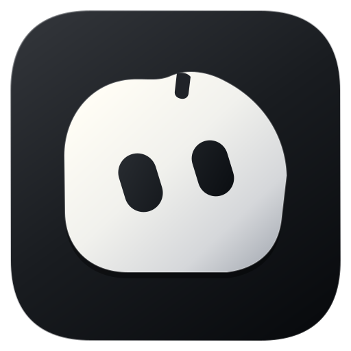
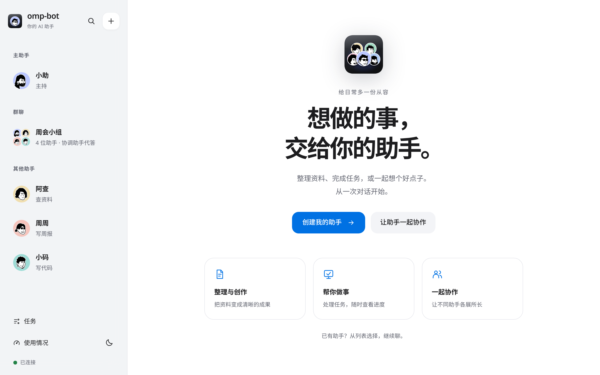

<div align="center">



# omp-bot

**A resident AI assistant team that lives on your computer.**

Name each assistant, customize its avatar, assign roles, dispatch tasks in 1-on-1 chats, or bring them into a group chat to collaborate.

[简体中文](README.md) · **English**

[](https://github.com/jryang1997/omp-bot/actions/workflows/ci.yml)
[](LICENSE)


[User Guide (ZH)](docs/guide.md) · [Development (ZH)](docs/development.md) · [Changelog](CHANGELOG.md)

</div>



## What It Does

- **A team, not a single chat box**: Create multiple assistants with distinct names, avatars, and specialties. A primary coordinator assistant orchestrates work across the team.
- **Direct & group chats**: Dispatch tasks in 1-on-1 DMs, or pull assistants into a group where they take turns speaking, respond to `@mentions`, and let the lead assistant synthesize results.
- **Bot-to-bot delegation**: One assistant can delegate a subtask to another and verify the returned deliverable under a shared token budget.
- **Shared Linux computer**: All assistants share a local Linux VM with isolated per-bot seats (`Xvfb` + `spacesd`) where they can browse the web, run commands, and install tools. Watch the live screen or take over mouse and keyboard at any time.
- **Git-backed team directory**: Shared rules, skills, team files, and per-assistant identities live inside a local Git repository with full revision history.
- **Android companion & Feishu (Lark)**: Pair the native Kotlin/Compose Android app via QR code to dispatch tasks, read replies, and approve tool calls on your phone — or connect a Feishu bot.
- **Three permission tiers**: `Chat only`, `Ask before modifying host (default)`, and `Full autonomy`. Sensitive credential directories (`~/.ssh`, cloud credentials, OMP auth store) are hard-blocked across all tiers.

Models are powered by [omp](https://omp.sh) (`oh-my-pi`), reusing the providers and credentials you already configured in `omp`.

## Supported Platforms

| Platform | Status |
|---|---|
| Windows x64 | Supported (Installer `.exe` and Portable `.zip`). Shared computer requires Windows Hypervisor Platform (WHPX) |
| Android 8.0+ | Native companion app (`android/`), pairs with a running desktop `omp-bot` instance over LAN |
| macOS / Linux | Core server and web workbench run from source (`node ompbot.mjs serve`); desktop installer and WHPX VM are Windows-only |

## Quick Start

### Run from Source

Requires **Node.js 24+** and **omp 18.10+** with at least one model configured in `omp`:

```sh
npm install
node ompbot.mjs serve
```

The web workbench opens automatically at `http://127.0.0.1:3099`.

### Build Desktop & Android Packages

- **Windows Desktop (`release/omp-bot-<version>-setup.exe` & `portable.zip`)**:
  ```sh
  npm run package:win
  ```
- **Android Companion APK (`release/omp-bot-android.apk`)**:
  ```sh
  npm run build:android
  ```

## Permission Tiers

| Tier | Capabilities |
|---|---|
| **Chat only** | No command execution, no file writes, no computer seat access |
| **Ask before modifying host (default)** | Reads/writes workspace files; prompts before running host commands or browser actions; runs freely inside the shared VM except for system package installation |
| **Full autonomy** | Runs without per-action prompts on host and VM (still prompts before system package installation) |

Tasks originating from Android or Feishu are capped at **Ask before modifying host**. `~/.ssh`, cloud credentials, and OMP login stores are blocked at every tier.

## Acknowledgments

- [DeepSeek-Bot](https://github.com/Fei2411/DeepSeek-Bot): Orchestration protocol inspiration and ported workbench UI components (retained under Apache-2.0).
- [Hermes Bot Mode](https://github.com/NousResearch/Hermes-Bot-Mode): Isolated bot profiles, per-member group sessions, and signed inter-bot message envelopes.
- [OpenMausBot](https://github.com/milind-soni/OpenMausBot): Group turn-taking, `@mention` relay, and Android companion foundations.
- [notion-avatar](https://github.com/Mayandev/notion-avatar): Avatar customization assets (Felix Wong's Noto avatar illustrations under CC0).
- [oh-my-pi / omp](https://github.com/can1357/oh-my-pi): Underlying agent harness providing RPC mode, host tool callbacks, session resumption, and context compaction.

## License

Original code is licensed under [MIT](LICENSE). Ported frontend and Android components retain their respective Apache-2.0 / MIT licenses — see [web/vendor/README.md](web/vendor/README.md) and [android/PROVENANCE.md](android/PROVENANCE.md).
